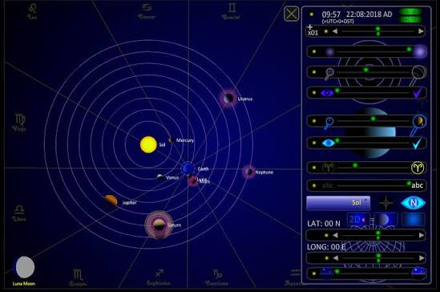
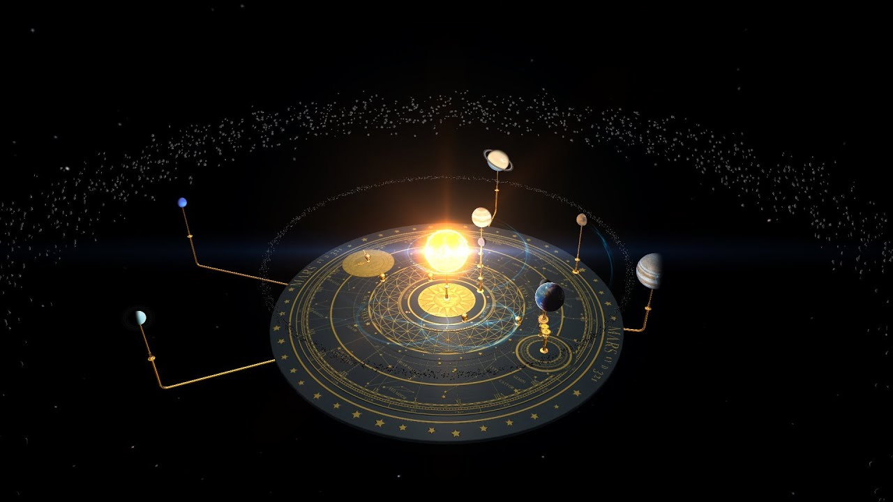
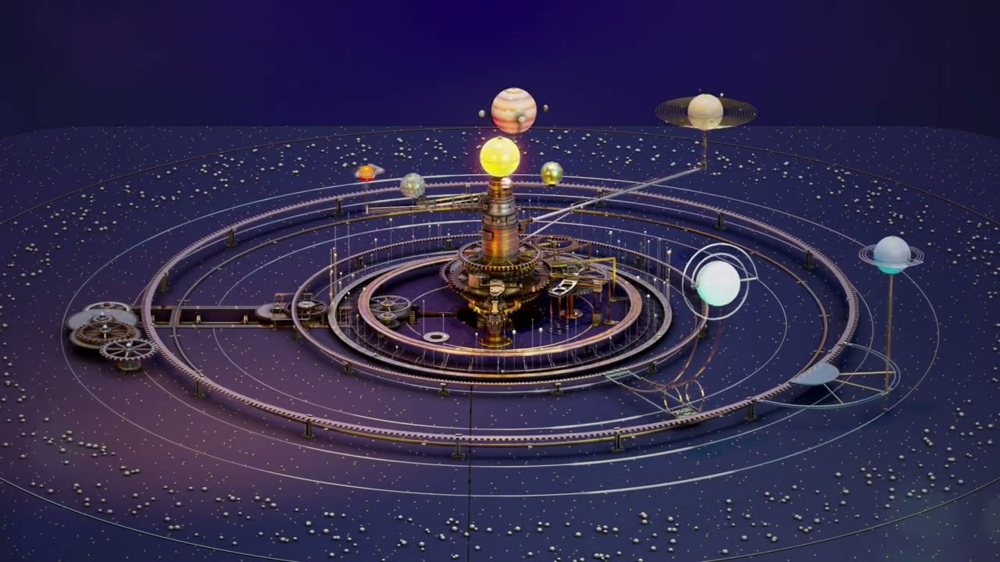

# Solar System Orrery

An orrery is a model of the solar system. Gears, cranks, or a clockwork drive move the planets so you can see who is ahead of whom. Solar System Orrery is that demonstration: the Sun in the middle, planets on paths, moons on the planets that have them.

Orrery Model is the same idea whether the gears are brass or the motion is drawn on a screen. digital orrery means the screen version. mechanical orrery means the geared version. grand orrery means the large set: the Sun and more of the known planets, sometimes with moons.

Inner planets lap the outer ones. That speed difference is the point of the model. A still diagram cannot show it.

A hand crank on a mechanical orrery turns every gear together. You do not push one planet and leave the others. The ratios are the lesson. A digital orrery keeps those ratios when you drag the time control instead of a crank.

Older machines stopped at Saturn because that was the last planet then known. A modern grand orrery can include Uranus and Neptune. Say which set you are looking at before you compare two models.

## Features

- The Sun at the center, planets on separate paths.
- Faster inner planets, slower outer planets.
- Moons that stay with their planet.
- Time you can run forward, slow down, or pause.
- A grand orrery layout when you want more than Sun, Earth, and Moon.

| Model | What it shows |
| --- | --- |
| Grand orrery | Sun and a wide set of planets, often with moons |
| Tellurion | Sun, Earth, and Moon: seasons and eclipses |
| Lunarium | Earth and the Moon only |
| Jovilabe | Jupiter and its moons |
| Digital orrery | The same motions on a screen |

The orbit record is [Orbit.js](Orbit.js). The drawn orbit path is [Orbit.jsx](orbit/Orbit.jsx). The motion code that steps a body along that path is [orbit.cpp](orbit/orbit.cpp).

The orbit banner is those paths around the Sun, not a night-sky photo. Play it. The inner bodies pull ahead. Pause it when you want to name one.

A planet on that path is [Planet.jsx](planet/Planet.jsx). The body record, mass and shape included, is [body.cpp](planet/body.cpp). The header for that record is [body.h](planet/body.h).

## Design

The mechanical piece uses gears so each planet has its own rate. The digital piece uses the same rates without teeth. Both are Orrery Model. Neither one is a telescope.

A line from a planet to a reference is [bodyLine.js](moon/bodyLine.js). Use it to see where a moon sits relative to its planet, not as a ruler for the room.

The name orrery comes from Charles Boyle, the 4th Earl of Orrery. Around 1713 he commissioned a model that John Rowley built. The word stuck for later machines that do the same job.

A grand orrery is large because each extra planet needs its own shaft and rate. Size is not decoration. A pocket tellurion can still teach seasons if Sun, Earth, and Moon keep their jobs.

## Solar system browser

The browser is a tree: Sun, then planets, then moons. Click a name and the view centers on it. You do not have to spin the whole grand orrery by hand to find Jupiter.

The tree of bodies is [qtsolarsystembrowser.h](view/qtsolarsystembrowser.h). The catalog of the system is [solarsys.h](catalog/solarsys.h). A grid drawn on a planet is [planetgrid.cpp](planet/planetgrid.cpp).

The planet grid is that tree in rows: name, who it orbits, and whether it has moons. A moon row belongs under its planet. It does not get its own path around the Sun.

## Star browser

A star list is a different tool. This model is the solar system. Distant stars are not gears in the orrery. If you only wanted planets, stay on the Sun and the bodies that go around it.

The eighteenth century machines were Newtonian clockwork: one drive, many rates, no hidden motor per planet. That is still the right picture for a mechanical orrery.

## Selecting objects by name

Type a planet or a moon. The match should be the body, not a nearby label. Common names are enough for the eight planets. A moon with a shared name needs the planet in front of it so you do not land on the wrong one.

Io belongs with Jupiter. A bare "Io" search is fine only when no other body uses that name in your catalog. If two labels match, keep the planet in the query.

Coordinates used when you pick a point on a path are [coords.js](orbit/coords.js).

A selected body should stay selected when you change the time rate. The highlight is a pointer, not a new orbit. Clearing the name returns you to the Sun.

## Known issues

A model that stops at Saturn is a historical orrery. Planets found later were not on the early machines. A grand orrery built for the eighteenth century is honest about its own date. It is not a broken modern list.

If a moon jumps, the time step is too coarse. Slow the rate. The clock is [Time.js](Time.js). The panel that sets that rate is [TimePanel.jsx](time/TimePanel.jsx). How a body turns on its axis is [rotation.h](time/rotation.h).

An eclipse in a tellurion is a lineup of Sun, Earth, and Moon, not a texture. If the three never line up, the moon gear or the moon rate is wrong. Check that subset before you blame the outer planets.

A geocentric orrery puts Earth in the middle. This page follows the Sun-centered model. Do not mix the two in one crank and then expect the seasons to match.

## User modifiable elements

You can hide a moon, change the time rate, or look from above the plane. You should not rewrite the published planet list to force a fake orbit. Add a note beside the model if you are comparing a historical machine with the current set of planets.

The gear editor is where a mechanical orrery would show ratios, and where a digital orrery shows the rate controls. One ratio per planet. Do not put the Earth gear on Mercury.

The view that frames the Sun and the planets is [camera.js](view/camera.js). The on-screen controls are [ControlPanel.js](view/ControlPanel.js).

## Performance

A digital orrery should stay smooth with the planets and their major moons. Turn off extra moons if a small machine stutters. The motion matters more than a sharp texture.

A mechanical orrery has no frame rate. If a hand sticks, the gear is dry or the crank was forced. Do not oil a museum piece. That object is not yours to service.

Pause before you take a reading. A moving hand makes a moon look attached to the wrong planet. One frozen frame is enough to name the body.

## Contributions

Descriptions of a historical machine should say which planets it includes. A photo of a grand orrery without that list is hard to compare with a digital run of the same date.

### Contributing

Corrections to a moon's period belong with the publisher of the model you are using. This page does not take a mail-in gear ratio.

## License

The explanation on this page is for the model as a teaching tool. The notice file in the tree is not a bill of sale and not a claim on a museum object.

A clockwork orrery and a digital orrery can share the same planet list. The license on the files does not transfer a brass machine.

## Fetch the model

One model. A digital orrery you can run, or a mechanical orrery you already have in front of you. One button for the digital build.

Orrery Model from a random shop photo is not this page's price list. This page does not quote a price.

### First look

Start at the Sun. Run time until Mercury has lapped the Earth once. Then pick a moon and watch it stay with its planet. If you wanted seasons and eclipses only, use the tellurion subset: Sun, Earth, Moon.

Name the planets out loud once. The order from the Sun is the order of the gears. A swapped label is a teaching error, not a new planet.

Leave the view above the plane for the first minute. An edge-on view hides which body is inner. You can tilt after the rates make sense.

## Related Questions

### Why is it called an orrery?

The name comes from Charles Boyle, 4th Earl of Orrery. He commissioned an early model around 1713, and John Rowley built it. Later sun-and-planet machines kept the name.

### Who owns the orrery?

There is no single owner. Famous historical pieces sit in museums, including the Smithsonian and the History of Science Museum. A mechanical orrery in a school or a digital orrery on a computer belongs to whoever holds that copy. This page does not assign one owner.

### What does the orrery do?

It shows relative positions and motions. Planets go around the Sun at different speeds. Moons go around planets. A grand orrery includes a larger set. A tellurion keeps Sun, Earth, and Moon so seasons and eclipses are easier to see.

### Can you buy an orrery?

Historical machines are museum objects, not a shelf product. Makers still sell mechanical models, and a digital orrery is the screen version of the same lesson. This page does not list a shop or a price. Learn the motions here, then decide if you want a physical machine.

## Related Search Terms

Solar System Orrery, Orrery Model, digital orrery, mechanical orrery, grand orrery, Topics: astronomy, solar-system, orrery, planets, orbits, educational, opengl, planetarium, space, simulation, moons, ephemeris
